# Story Connect - Policy Evidence Engine

Auditable evidence-grounded policy review: every claim traces to exact source quotes, explicit uncertainty, and reviewer challenges.

> Local synthetic prototype for the Meta Global AI Developer Hackathon. All records and policies are fictional. No authentication. Human review is required. Not for employment decisions or production use.

## Table of contents

- [Problem and target users](#problem-and-target-users)
- [Solution and end-to-end workflow](#solution-and-end-to-end-workflow)
- [Why this is more than basic RAG](#why-this-is-more-than-basic-rag)
- [Meta AI integration](#meta-ai-integration)
- [Policy Demo providers (Baseten and Meta)](#policy-demo-providers-baseten-and-meta)
- [Architecture](#architecture)
- [Core features and evidence grounding](#core-features-and-evidence-grounding)
- [Technology stack](#technology-stack)
- [Demo walkthrough](#demo-walkthrough)
- [Evaluation reliability and safety](#evaluation-reliability-and-safety)
- [Installation and local setup](#installation-and-local-setup)
- [Selected repository structure](#selected-repository-structure)
- [Limitations and next steps](#limitations-and-next-steps)
- [Hackathon team](#hackathon-team)

Full documentation index: [`docs/project/PROJECT_DOCUMENTATION_INDEX.md`](docs/project/PROJECT_DOCUMENTATION_INDEX.md).

## Problem and target users

Policy changes affect claims whose evidence and applicability are spread across versions, passages, and dependent conclusions. A chatbot answer can quote a document without showing which claims rely on it, whether the quote supports the claim, or what else needs review.

Target users: policy owners, operations reviewers, and analysts who compare policy versions and inspect evidence. Expected value: faster, more traceable review with clearer uncertainty, conflict, and follow-up work. No measured business benefit is claimed.

This repo contains two separate local prototypes sharing one React frontend:

- Handover investigation: review recurring missing information in hotel shift handovers.
- Policy Demo: compare fictional Grand Luminary Hotel policy versions, challenge department applicability, and inspect recomputation.

## Solution and end-to-end workflow

Reviewer flow for the Policy Demo at `http://127.0.0.1:5174/#/demo`:

1. List scenarios and request one scenario.
2. Inspect versions, passages, and citations.
3. Create an in-memory session bound to the displayed proposal id.
4. Submit a department challenge.
5. Inspect the recomputed result and session history.

Reviewer flow for handover investigations:

1. Create an investigation from a fixed preset question.
2. Inspect claims across five fixed hypotheses with evidence stances and uncertainty.
3. Challenge a claim with a source record id and exact quote.
4. Inspect recomputation; on a 409 the investigation changed mid-computation, so reload and retry.
5. Read the append-only history.

Deterministic local code owns validation, status, dependencies, versions, and history. Model output is treated as untrusted proposals only: proposals outside the strict response contract become provider errors, never silent results.

## Why this is more than basic RAG

- The unit of reasoning is a linked set of versioned sources, passages, claims, dependencies, challenges, and history rows, not one answer string.
- Claims carry stored dependencies and every claim version is persisted; challenges recompute against a captured revision guarded by a conditional version update.
- Exact quotation proves provenance only. The engine requires an exact-substring quote, then applies a separate phrase-level guard review with reason codes.
- Uncertainty is explicit: `SUPPORTED`, `PARTIAL`, `CONTRADICTED`, `INSUFFICIENT`, with stances `SUPPORTS`, `CONTRADICTS`, `NEUTRAL`.
- The implementation contains no vector database or embedding pipeline. Ingest notes chunking and embedding as deliberately not done, deferred to a later phase.

## Meta AI integration

Handover backend (`backend/app/main.py`). Mock remains the default; Meta is opt-in and backend only.

- Default: `MockProvider` when neither provider is requested, when both are requested, or when activation is incomplete.
- Opt-in: `ENABLE_META=1` plus backend-only `MODEL_API_KEY`, `META_MAX_REQUESTS`, `META_MAX_ESTIMATED_COST_USD`, `META_CONSERVATIVE_COST_PER_REQUEST_USD`.
- Conflict: `ENABLE_META` and `ENABLE_BASETEN` together fail closed to the mock provider.
- Pinned transport: `https://api.meta.ai/v1/chat/completions`, model `muse-spark-1.3`.
- After activation, provider failures do not fall back to mock. They surface as provider errors mapped to 413 or 503 responses.
- The credential stays in the backend process environment and must never reach the React/Vite application.

Details: [`backend/META_PROVIDER.md`](backend/META_PROVIDER.md).

Enabling Meta does not connect the Policy Demo or the policy-comparison API to Meta; those use separate provider modules. No HR policy Q and A or document retrieval is implemented. No live Meta runs are claimed in this README.

## Policy Demo providers (Baseten and Meta)

Policy Demo (`backend/policy_demo_api.py` with `backend/policy_baseten_provider.py`). Synthetic is the default; remote providers are opt-in per backend process.

- Selection: `POLICY_DEMO_PROVIDER` accepts `synthetic`, `meta`, or `baseten` and defaults to `synthetic`.
- Baseten: `https://inference.baseten.co/v1/chat/completions`, model `meta-models/muse-spark-open-1026`, keyed by backend-only `BASETEN_API_KEY` with `POLICY_DEMO_BASETEN_MAX_REQUESTS`, `POLICY_DEMO_BASETEN_MAX_ESTIMATED_COST_USD`, and `POLICY_DEMO_BASETEN_CONSERVATIVE_COST_PER_REQUEST_USD`.
- Meta demo path: `https://api.meta.ai/v1/chat/completions`, model `muse-spark-1.3`, keyed by backend-only `MODEL_API_KEY` with the `META_*` budget variables. It shares the same builder, call path, and error mapping as Baseten.
- The provider and its budget gate initialize once per process; unknown selections, missing keys, and bad budgets raise sanitized provider errors.
- Each scenario request resolves the provider and runs the initial investigation; failures return 503 (429 on budget exhaustion) with no silent fallback to synthetic output.
- `GET /demo-api/provider-status` is loopback only and reports the configured provider without initializing it.

Live Baseten execution has not been verified successfully per [`backend/POLICY_BASETEN_PROVIDER.md`](backend/POLICY_BASETEN_PROVIDER.md), which documents Baseten activation. Offline tests exist for both adapters (`test_policy_baseten_provider.py`, `test_policy_meta_provider.py`); no test runs or live runs are claimed here.

## Architecture

Based on actual routes and modules. All loopback addresses below are literal.

```mermaid
flowchart LR
  Reviewer[Reviewer in browser] --> UI[React Vite UI 127.0.0.1:5174]
  UI -->|api| HAPI[Handover API 8081]
  UI -->|demo api| DAPI[Policy Demo API 8083]
  HAPI --> Engine[AssessmentEngine validation and status]
  Engine --> Guard[Phrase guard with reason codes]
  Engine --> Mock[MockProvider default]
  Engine -->|opt in| Meta[Meta Muse Spark]
  HAPI --> Store[(SQLite prototype database)]
  DAPI --> DemoLogic[Policy evidence demo scenarios]
  DAPI --> Sessions[(In-memory sessions)]
  DAPI --> Synth[Synthetic provider default]
  DAPI -->|opt in| Baseten[Baseten Muse Spark Open]
  DAPI -->|opt in| DMeta[Meta demo provider]
  DAPI --> Contract[Strict proposal contract]
  Compare[Policy API 8082 Fake adapter] -. isolated not proxied .-> Reviewer
```



Component map:

- `frontend/src/App.tsx`, `frontend/src/PolicyDemoPage.tsx`: handover page and `#/demo` policy page.
- `frontend/vite.config.ts`: serves `127.0.0.1:5174` and proxies `/api` to 8081 and `/demo-api` to 8083.
- `backend/app/main.py`: handover FastAPI on 8081 with SQLite store.
- `backend/policy_demo_api.py`: demo FastAPI on 8083 with bounded in-memory sessions.
- `backend/policy_api.py`: isolated comparison API fixed to `127.0.0.1:8082` with the fake candidate adapter.
- `backend/policy_dependency_graph.py`, `backend/policy_challenge_propagation.py`: typed graph and bounded impact-planning modules.
- `frontend/public/policy-comparison-demo.html`: standalone local comparison page.

More detail: [`docs/project/SYSTEM_ARCHITECTURE.md`](docs/project/SYSTEM_ARCHITECTURE.md) and [`docs/project/BACKEND_AND_API_DOCUMENTATION.md`](docs/project/BACKEND_AND_API_DOCUMENTATION.md).

## Core features and evidence grounding

Handover investigation:

- Five fixed hypotheses: `CHECKLIST_UNAVAILABLE`, `TRAINING_GAP`, `STAFFING_CONSTRAINTS`, `PMS_SYSTEM_ISSUE`, `TIME_PRESSURE`, with fixed preset questions chosen server-side.
- Routes: `GET /api/health`, `GET /api/records`, `POST /api/records/ingest`, `POST /api/investigations`, `GET /api/investigations/{id}`, `POST /api/investigations/{id}/claims/{claim_id}/challenge`, `GET /api/investigations/{id}/history`.
- Challenge payload: `reason` (min 8 chars), `source_record_id`, and `quote` (min 3 chars, exact substring of stored text, control characters refused).
- Records older than 90 days or dated in the future are stale and cannot count as current evidence.
- Restricted rows are excluded by default from listings, lookups, ingest matching, and engine input. No endpoint exposes them.
- Revisions are versioned and append-only: claim versions and history are inserted, never updated; the challenge write is guarded by a conditional version update and stale computations return 409.

Policy Demo:

- Routes: `GET /demo-api/health`, `GET /demo-api/provider-status`, `GET /demo-api/scenarios`, `GET /demo-api/scenario`, `POST /demo-api/session/new`, `GET /demo-api/session/{id}/history`, `POST /demo-api/session/{id}/reset`, `POST /demo-api/challenge`.
- Scenarios use fictional Grand Luminary Hotel documents: scheduling policy revisions, uniform-standards contradiction, and lounge scope/time difference.
- Each scenario response registers a `proposal_id`; sessions are held by a bounded in-memory manager (100 sessions, 100 pending proposals).
- Session creation is UI-driven: the page posts scenario_id and proposal_id to POST /demo-api/session/new (proposal_id is required; scenario_id defaults to scheduling).
- Challenges and history are served from server-side session state; provider failures return sanitized errors.

Guard and boundaries:

- The guard scans quoted text against a fixed cue inventory and returns reason-coded decisions such as cue match vs mismatch, with an explicit unguarded baseline when disabled.
- Guard rationales use fixed non-causal wording; proposals stay available for human review instead of being silently rewritten.
- The guard cannot reliably handle paraphrase, negation, context, partial entailment, or causation. Quote presence is provenance, not semantic support.

Comparison API:

- Strict synthetic input, fake candidate adapter, proposal-only output with explicit uncertainty reasons and semantic support marked unassessed. Every result requires human review.

## Technology stack

- Backend: Python 3 with `pip`; FastAPI, Uvicorn, Pydantic, Pytest, HTTPX per [`backend/requirements.txt`](backend/requirements.txt); SQLite for the handover store.
- Frontend: Node.js with `npm`; React 19, TypeScript, Vite 6 per [`frontend/package.json`](frontend/package.json). Frontend tests use `--experimental-strip-types`.
- No vector database, embedding pipeline, or authentication framework is in the traced implementation. The health payload reports authentication as disabled.

## Demo walkthrough

Policy Demo, offline synthetic default:

```powershell
python -m venv .venv
.\.venv\Scripts\Activate.ps1
python -m pip install -r backend/requirements.txt
cd frontend
npm ci
cd ..
python scripts/launch_policy_demo.py
```

Open `http://127.0.0.1:5174/#/demo`. The launcher starts only the demo API on `127.0.0.1:8083` and Vite on `127.0.0.1:5174`; it does not start the handover backend or the comparison API. Press Ctrl+C to stop the foreground launcher, or run `python scripts/launch_policy_demo.py --stop` for tracked background processes.

In the UI: list scenarios, open the scheduling scenario, create a session from its proposal, submit a department challenge, then read history. Expect `INCONCLUSIVE`-style proposal-only outcomes where grounding is absent.

Handover prototype, separate terminal:

```powershell
$env:PYTHONPATH = (Resolve-Path backend).Path
python -m app.store init
python -m uvicorn app.main:app --host 127.0.0.1 --port 8081
```

```powershell
cd frontend
npm run dev
```

The database file is created by init (default `data/prototype.sqlite3`); HACKATHON_DB_PATH may select another path that stays inside the repository data/ directory; paths outside it are rejected at startup. API docs are served by FastAPI at `http://127.0.0.1:8081/docs`.

In the UI at `http://127.0.0.1:5174/`: create an investigation, inspect hypotheses and evidence, challenge one claim with an exact source quote, then inspect versions and history.

Standalone comparison API, isolated:

```powershell
$env:PYTHONPATH = (Resolve-Path backend).Path
python -m policy_api
```

Serves fixed `127.0.0.1:8082` with no port fallback. Not proxied by Vite.

Demo-video assets exist under `demo-video/` (scene images, overlays, `architecture.png`, `thumbnail.png`); their contents were not reviewed for this README.

## Evaluation reliability and safety

Implemented:

- Synthetic gold set: [`backend/evaluation/gold_cases.json`](backend/evaluation/gold_cases.json), 21 cases: 6 with `mock` provider mode and 15 `adversarial_fixture` (10 flagged `semantic_review`). Labels are fixture judgments assigned before running the engine, not engine-derived results.
- Offline harness: `python -m app.evaluate` with `MockProvider` only. It reports unguarded and guarded results over the same cases with frozen denominators and false-support/false-neutral style rates, and verifies disposable databases are removed afterwards.
- Run from the repository root:

```powershell
$env:PYTHONPATH = (Resolve-Path backend).Path
.\.venv\Scripts\python.exe -m app.evaluate
```

- Backend suite: 107 test files under `backend/tests/` plus `conftest.py` and `provider_test_support.py`, covering API, engine, store, providers, policy modules, guards, decision tables, transport, and launcher areas.
- Frontend checks: `npm test`, `npm run typecheck`, `npm run build` from `frontend/`.
- Safety: loopback-only local servers, backend-only credentials via process environment or allowlisted `backend/.env`, no `.env` loading in tests, bounded request bodies, sanitized provider errors, a registered rate-limit middleware on handover routes, explicit database init with refusal until initialized, and no silent provider fallback on either engine.

Not claimed: no test was executed for this README, so no pass/fail statement is made; no numeric accuracy is reported; the 21-case set is a regression harness, not a general performance estimate. Live Meta and Baseten runs are not claimed.

## Installation and local setup

Requirements:

- Python 3 with `pip`.
- Node.js with `npm`. Frontend tests use the `--experimental-strip-types` flag.

Backend:

```powershell
python -m venv .venv
.\.venv\Scripts\Activate.ps1
python -m pip install -r backend/requirements.txt
```

Frontend:

```powershell
cd frontend
npm ci
```

Optional live providers, backend process only:

```powershell
$env:ENABLE_META = "1"
$env:MODEL_API_KEY = "<backend-only key>"
$env:META_MAX_REQUESTS = "1"
$env:META_MAX_ESTIMATED_COST_USD = "1"
$env:META_CONSERVATIVE_COST_PER_REQUEST_USD = "1"
```

```powershell
$env:POLICY_DEMO_PROVIDER = "baseten"
$env:BASETEN_API_KEY = "<backend-only key>"
$env:POLICY_DEMO_BASETEN_MAX_REQUESTS = "1"
$env:POLICY_DEMO_BASETEN_MAX_ESTIMATED_COST_USD = "1"
$env:POLICY_DEMO_BASETEN_CONSERVATIVE_COST_PER_REQUEST_USD = "1"
```

Never put keys in Vite variables, source, or commits. `backend/META_PROVIDER.md` and `backend/POLICY_BASETEN_PROVIDER.md` define the full boundary. Provider selection initializes once per backend process, so restart the backend after changing provider configuration.

## Selected repository structure

```text
README.md
pytest.ini
.gitignore
backend/
  policy_api.py
  policy_baseten_provider.py
  policy_candidate_adapter.py
  policy_challenge_propagation.py
  policy_compare.py
  policy_demo_api.py
  policy_demo_session.py
  policy_dependency_graph.py
  policy_evidence_demo.py
  policy_mock_provider_runner.py
  policy_orchestration.py
  policy_proposal_contract.py
  META_PROVIDER.md
  POLICY_BASETEN_PROVIDER.md
  POLICY_API.md
  (plus 7 further design and spec docs)
  requirements.txt
  app/
    main.py
    engine.py
    store.py
    models.py
    semantic_guard.py
    evaluate.py
    provider_activation.py
    provider_safety.py
    httpx_transport.py
    mock_provider.py
    local_env.py
    ingest.py
    decision_table.py
    stance_algebra.py
    evidence_coverage.py
    evidence_frames.py
    scope_layer.py
    rate_limit.py
    access.py
    calibration.py
    dependency_graph.py
    experiment_control.py
    experiment_manifest.py
    provider_replay.py
  evaluation/
    gold_cases.json
    protocol_v1.py
    protocol_fixtures.py
  tests/ (107 test files, conftest.py, provider_test_support.py)
frontend/
  src/
    App.tsx
    PolicyDemoPage.tsx
    api.ts
    contracts.ts
    policyDemoState.ts
    policyDemoContract.ts
    challengeWorkflow.ts
    historyState.ts
    auditParsers.ts
    presentation.ts
    main.tsx
    styles.css
  vite.config.ts
  package.json
  index.html
  public/policy-comparison-demo.html
docs/
  project/ (16 files, indexed by PROJECT_DOCUMENTATION_INDEX.md)
scripts/
  launch_policy_demo.py
  launch_policy_demo.ps1
  check_policy_demo_health.py
  quality_gate.py
  e2e_safety.py
  test_e2e_safety.py
demo-video/
data/
ct3/ (verification notes and proof artifacts)
```

Local databases, `.env` files, build output, and caches are gitignored. `.policy_demo_runtime.json` is launcher runtime state; leave it in place.

## Limitations and next steps

Current limitations:

- Synthetic data only. No real policy ingestion, HR Q and A, or document retrieval.
- Policy Demo sessions live in a bounded in-memory manager and do not survive restarts.
- The guard is fixed phrase-cue matching with documented paraphrase, negation, and context limits. It does not establish general entailment or causation.
- Policy graph and challenge-planning modules are present; per project docs, graph persistence remains documentation/specification only, database execution is BLOCKED, and the prototype gate is CLOSED.
- The handover app has no authentication.
- The comparison API is fake-adapter only with semantic support unassessed; every result needs human review.
- Live Baseten execution is not verified. No live Meta runs are claimed. No test outcomes are claimed.

Planned, not implemented:

- Owner-approved persistence mapping, durable audit, and gate transition.
- Generic graph-backed challenge UI with full reassessment across arbitrary dependencies.
- Broader semantic validation to replace phrase cues, with calibrated uncertainty.
- Authentication, retention, deployment controls, and production hardening.

## Hackathon team

Team: policy-evidence-engine
Team number: 4117
