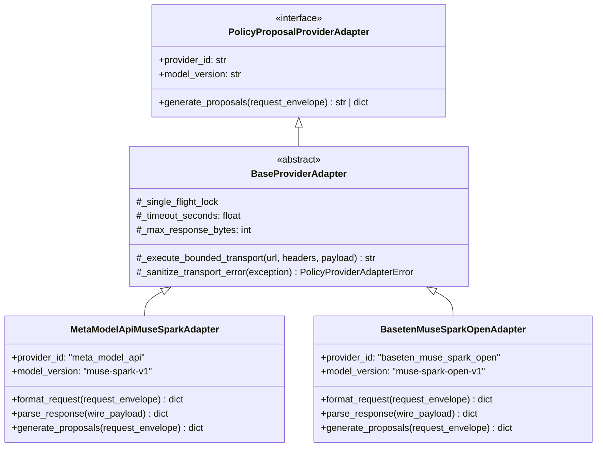

# Policy Provider Adapter Seam Design

## 1. Status, Scope, and Governance Baseline

### 1.1 Status
**Design only.** This document specifies the offline integration seam between the existing synthetic policy-comparison workflow and future AI providers (focusing on Muse Spark via Meta Model API, with Baseten / Muse Spark Open as an alternative deployment target).

This document does **not**:
- Implement or alter runtime application code, tests, or configuration.
- Authorize or activate any external provider, network transport, or API communication.
- Configure, read, or manage real API keys, credentials, or secrets.
- Authorize dataset creation, annotation, or model evaluation.
- Access the employee handover application, its database (`.e2e-phase34.sqlite3`), or its `AssessmentEngine`.

### 1.2 Mandatory Domain Invariants
All policy comparison proposals must strictly adhere to the established domain and contract invariants:
1. **Five Canonical Relation Labels**: Exactly five classifications are permitted:
   - `CONTRADICTION` (two-sided)
   - `COMPATIBLE_CHANGE` (two-sided)
   - `NEW_RULE` (one-sided, newer version only)
   - `SCOPE_OR_TIME_DIFFERENCE` (two-sided)
   - `INCONCLUSIVE` (pair-level item or abstention)
   No provider errors, operational failures, impact statuses, or confidence scores may be represented as relation labels.
2. **Immutable Proposal Metadata**:
   - `status`: Fixed to `PROPOSAL_ONLY`.
   - `semantic_support`: Fixed to `NOT_VERIFIED`.
   - `human_review_required`: Fixed to `true`.
3. **Impact Status (Governance vs. Runtime)**:
   - *Governance Level*: Operational impact analysis remains unassessed and outside the proposal contract. At the governance and specification level (e.g., `POLICY_DATASET_SCHEMA_SPEC.md`), impact is categorized as `NOT_EVALUATED`.
   - *Runtime Representation*: The string `NOT_EVALUATED` is an illustrative governance policy statement; it is **not** a dictionary value emitted by the policy comparison code. In `policy_compare.py`, `impact["status"]` is strictly constrained to `{"PROPOSED", "INCONCLUSIVE"}`. The governance requirement is implemented at runtime by `_map_candidate()` setting `impact_targets: []` and `impact_coverage: "INCOMPLETE"`, which causes `compare_candidate()` and `validate_result()` to produce:
     - `impact_targets: []`
     - `impact_coverage: "INCOMPLETE"`
     - `impact["status"]: "INCONCLUSIVE"`
   No runtime behavior is altered and no new status fields are introduced.
4. **Precedence**: Precedence remains unassessed by models; orchestration sets `precedence` to `{"status": "UNRESOLVED", "support": "INSUFFICIENT", "citations": []}`.
5. **Epistemic Boundary**: Citation provenance confirms only that a cited text excerpt exists at an exact location within a synthetic passage. Citation provenance is **never** semantic proof. A language model proposal cannot approve a policy change, establish policy truth, or override human adjudication.
6. **Architectural Separation**: The policy-comparison workflow is strictly decoupled from the employee handover application, its `AssessmentEngine`, `MockProvider`, `BoundedTransportProvider`, and relational data stores.

---

## 2. Architectural Seam and End-to-End Request/Response Flow

### 2.1 Current Offline API Pipeline (Active Runtime)
In the current implementation:
1. `policy_api.py` receives a JSON request at `POST /policy-comparisons`.
2. `validate_policy_pair()` validates the payload into a frozen `PolicyPair` domain structure (ensuring exact types, passage boundaries, and non-empty texts).
3. `policy_api.py` constructs a deterministic `FakePolicyCandidateAdapter` via `_fixture_adapter(pair)`.
4. `orchestrate_policy_comparison()` in `policy_orchestration.py` accepts `(pair, adapter)`.
5. `generate_from_fake()` enforces an exact type check (`type(adapter) is FakePolicyCandidateAdapter`), invokes `adapter.generate(pair)`, and runs `validate_candidate_response()`.
6. Candidate proposals are mapped to core comparison structures via `_map_candidate()` and checked via `compare_candidate()` and `validate_result()`.

### 2.2 Clarification of the Two Distinct Request Paths
The architecture maintains a strict separation between the active offline API path and the proposed future provider-neutral path. The two paths differ in invocation entry point, adapter interface, and response schema.

#### Path A: Current Offline API Path (Active Runtime)
```
policy_api.py (POST /policy-comparisons)
    │
    ▼
validate_policy_pair(payload) ──► PolicyPair
    │
    ▼
_fixture_adapter(pair) ──► FakePolicyCandidateAdapter
    │
    ▼
orchestrate_policy_comparison(payload, adapter)
    │
    ▼
generate_from_fake(adapter, pair)  [Exact type check: type(adapter) is FakePolicyCandidateAdapter]
    │
    ▼
validate_candidate_response(pair, raw_fixture)  [Requires full citations & candidate_id; NO request_id]
    │
    ▼
_map_candidate() ──► compare_candidate() ──► validate_result()
```

#### Path B: Proposed Future Provider-Neutral Path (Design Only, Future Runner)
```
Validated PolicyPair
    │
    ▼
build_proposal_request(pair) ──► Bounded Proposal Request Envelope (max 512 KB, 50k nodes)
    │
    ▼
Multi-Gate Activation Predicate  [Fails closed if any gate fails]
    │
    ▼
PolicyProposalProviderAdapter.generate_proposals(request_envelope)  [Future authorized adapter]
    │
    ▼
Untrusted Model Response Payload (max 64 KB, 20k nodes)
    │
    ▼
normalize_proposal_response(pair, request, raw_response)  [Requires request_id & citation_hints; NO citations/candidate_id]
    │   ├── Rebuild exact citation provenance from passage text
    │   ├── Validate relation labels and arity
    │   └── Enforce mandatory uncertainty reasons
    │
    ▼
validate_candidate_response(pair, canonical_proposals)
    │
    ▼
_map_candidate() ──► compare_candidate() ──► validate_result()
```



```mermaid
flowchart TD
    subgraph PathA["Path A: Current Offline API Path (Active Runtime)"]
        ClientReq["Client POST /policy-comparisons"] --> ValPairA["validate_policy_pair()"]
        ValPairA --> PairA["PolicyPair"]
        PairA --> FixtureAdapt["_fixture_adapter(pair)\n(FakePolicyCandidateAdapter)"]
        FixtureAdapt --> OrchA["orchestrate_policy_comparison()"]
        OrchA --> GenFake["generate_from_fake()\n[type(adapter) is FakePolicyCandidateAdapter]"]
        GenFake --> ValCandA["validate_candidate_response()\n[Fixture schema: full citations, candidate_id]"]
        ValCandA --> CoreA["_map_candidate() -> compare_candidate() -> validate_result()"]
    end

    subgraph PathB["Path B: Proposed Provider-Neutral Path (Future Offline Runner)"]
        PairB["Validated PolicyPair"] --> BuildReq["build_proposal_request(pair)"]
        BuildReq --> BoundedReq["Bounded Request Envelope\n(max 512 KB, 50k nodes)"]
        BoundedReq --> GateB{"Multi-Gate Activation\n(Fails closed if unapproved)"}
        GateB -- "Authorized & Active" --> RemoteAdapter["PolicyProposalProviderAdapter\n(Meta Model API / Baseten)"]
        RemoteAdapter --> RawModelResp["Untrusted Response Payload\n(max 64 KB, 20k nodes)"]
        RawModelResp --> Normalizer["normalize_proposal_response(pair, request, raw)\n[Contract schema: request_id, citation_hints]"]
        Normalizer --> RebuildProv["Rebuild Citation Provenance\n& Validate Relation / Uncertainty"]
        RebuildProv --> ValCandB["validate_candidate_response()\n[Delegated validation]"]
        ValCandB --> CoreB["_map_candidate() -> compare_candidate() -> validate_result()"]
    end
```

#### Key Invariants Between the Two Paths
1. **Schema Non-Equivalence**: The fixture response produced by `_fixture_adapter` is **never** input to `normalize_proposal_response`. The fixture schema contains pre-computed `citations` and a `candidate_id` without a `request_id`, whereas `normalize_proposal_response` requires `request_id` and `citation_hints` while strictly rejecting model-supplied `citations` and `candidate_id`.
2. **No Adapter Injection in Current API**: The proposed provider adapter is **not** added to `policy_api.py` or default runtime entry points.
3. **Exact-Type Check Preserved**: The strict type check in `generate_from_fake` (`if type(adapter) is not FakePolicyCandidateAdapter: _invalid()`) is **never** weakened, bypassed, or modified.
4. **Isolated Execution Context**: Any future execution of `PolicyProposalProviderAdapter` must run in an independently authorized, offline evaluation harness or test runner, completely separate from the `policy_api.py` HTTP listener.

### 2.3 Seam Invariants
1. **Never Consume Raw HTTP Input**: The adapter interface never consumes unvalidated client HTTP payloads. It only receives the bounded envelope produced by `build_proposal_request(pair)`.
2. **Never Produce Final Decisions**: The adapter produces an untrusted, candidate-shaped proposal envelope. It has no authority to alter proposal statuses, validate citations, or construct final comparison results.
3. **No Direct Transport Injection in Orchestration**: Orchestration requires a validated provider interface. In the offline state, orchestration strictly restricts execution to `FakePolicyCandidateAdapter`.

---

## 3. Provider-Neutral Adapter Interface Specification

### 3.1 Conceptual Protocol
The adapter interface defines a uniform protocol for candidate proposal generation. It hides transport details, provider endpoints, and vendor wire formats behind a provider-neutral boundary.

```python
from typing import Any, Protocol

class PolicyProposalProviderAdapter(Protocol):
    """Provider-neutral seam for untrusted policy comparison candidate generators.
    
    Consumes ONLY the bounded proposal request envelope generated by
    policy_proposal_contract.build_proposal_request(). Returns an untrusted
    JSON-serializable candidate response structure for local normalization.
    """

    @property
    def provider_id(self) -> str:
        """Stable, non-secret identifier for the provider implementation."""
        ...

    @property
    def model_version(self) -> str:
        """Exact pinned model identifier and revision."""
        ...

    def generate_proposals(self, request_envelope: dict[str, Any]) -> str | dict[str, Any]:
        """Execute a single bounded proposal exchange.
        
        Args:
            request_envelope: Bounded proposal request generated by
                build_proposal_request(pair).
                
        Returns:
            Raw JSON string or decoded dictionary matching the candidate
            proposal response schema.
            
        Raises:
            PolicyProviderAdapterError: On transport timeout, network drop,
                payload overage, non-2xx response, or disabled state.
        """
        ...
```

### 3.2 Standardized Sanitized Error Taxonomy
Under no circumstances may raw provider error messages, server stack traces, endpoint URLs, or authorization headers escape the adapter boundary. The adapter must map all transport and provider anomalies into a fixed, safe error class:

```python
class PolicyProviderAdapterError(Exception):
    """Sanitized adapter error; never includes raw vendor or transport details."""
    
    def __init__(self, code: str, message: str) -> None:
        self.code = code
        super().__init__(message)

# Standardized error codes:
# - "provider_disabled": Provider is not activated or gate conditions are unmet.
# - "transport_timeout": Remote call exceeded strict deadline.
# - "transport_canceled": Operation was canceled by the runtime caller.
# - "transport_failure": Network connection failure, drop, or non-2xx status.
# - "oversized_payload": Response exceeded byte or node limits before full read.
# - "invalid_transport_response": Provider returned malformed or non-JSON payload.
# - "concurrency_limit_exceeded": Single-flight execution slot is occupied.
```

### 3.3 Execution Constraints (Design Requirements for Future Implementation)
1. **Single-Flight Process Execution**: The adapter must maintain a process-local, non-blocking single-flight lock. Overlapping generation attempts must fail immediately with `concurrency_limit_exceeded` without queueing or retrying.
2. **Strict Timeouts**: A bounded timeout (e.g., maximum 20.0 seconds) must be enforced via an explicit async timeout or transport deadline.
3. **No Retries**: Zero automatic retries. If a request fails, times out, or receives a non-2xx response, it immediately fails closed to prevent silent quota consumption or duplicate billing.
4. **Pre-Parse Response Caps**: Response streaming must abort if the incoming stream exceeds `MAX_RESPONSE_BYTES` (64,000 bytes) before allocating memory for deserialization.

### 3.4 Distinction Between Existing Guarantees and Proposed Requirements
To ensure clear engineering boundaries, controls verified in the current policy prototype must be explicitly distinguished from controls proposed for future provider adapters:

| Control Category | Control Description | Status in Current Policy Prototype | Status in Proposed Provider Adapter |
|---|---|---|---|
| **Request Bounds** | Canonical JSON byte limit (512 KB) & node limit (50,000) | **Existing Guarantee**: Enforced by `policy_proposal_contract.build_proposal_request()`. | Inherited from caller; adapter receives pre-bounded request envelope. |
| **Response Decoded Bounds** | In-memory parsed byte limit (64 KB), candidate limit (20), node/depth bounds | **Existing Guarantee**: Enforced by `policy_proposal_contract.normalize_proposal_response()`. | Downstream validator enforces before domain core mapping. |
| **Provenance Verification** | Local derivation of offsets, exact single-match quote verification in passages | **Existing Guarantee**: Enforced by `policy_proposal_contract.normalize_proposal_response()`. | Adapter is prohibited from deriving provenance. |
| **Relation & Uncertainty Invariants** | Five labels, arity rules, mandatory `semantic_support_unverified` | **Existing Guarantee**: Enforced by `policy_candidate_adapter.validate_candidate_response()`. | Adapter has no relation-validation authority. |
| **Streaming Chunk Abort** | Aborting raw HTTP chunk stream if bytes exceed 64 KB before full parsing | **Not Implemented**: Current prototype parses responses in-memory after receipt. | **Proposed Future Requirement**: Must be implemented in `BaseProviderAdapter`. |
| **Transport Deadline** | Strict 20.0-second async execution deadline | **Not Implemented**: Prototype is purely synchronous and in-memory. | **Proposed Future Requirement**: Must be implemented in `BaseProviderAdapter`. |
| **Single-Flight Concurrency** | Process-local non-blocking slot rejecting overlapping calls | **Not Implemented**: Does not exist in policy backend (existed only in handover app). | **Proposed Future Requirement**: Must be implemented in `BaseProviderAdapter`. |
| **Cancellation Handling** | Graceful cancellation of in-flight transport tasks releasing resources | **Not Implemented**: Prototype has no async transport tasks. | **Proposed Future Requirement**: Must be implemented in `BaseProviderAdapter`. |
| **Zero Retries** | Immediate fail-closed abort on transport error or timeout without retry | **Existing Property**: Synchronous prototype has no retry logic. | **Proposed Future Requirement**: Transport client must be configured with `retries=0`. |

> [!WARNING]
> Documenting a safeguard in this design does **not** mean it already exists, is enabled, or has been tested in the policy comparison prototype. All transport-level controls (streaming chunk limits, deadlines, single-flight slots, cancellation, zero retries) are future requirements that must be independently implemented and verified before any remote activation.

---

## 4. Division of Responsibilities: Adapter vs. Local Validator

To prevent security compromises, hallucinated citations, or provider overreach, responsibilities are partitioned strictly between the adapter and local verification code.

| Responsibility Area | Provider Adapter | Local Code (`policy_proposal_contract.py`, `policy_candidate_adapter.py`, `policy_compare.py`) |
|---|---|---|
| **Request Pre-Validation** | None. Assumes caller supplies the strictly typed `request_envelope`. | `build_proposal_request` round-trips `pair` through `validate_policy_pair` and bounds canonical JSON to 512,000 bytes and 50,000 nodes. |
| **Vendor Request Formatting** | Formats system/user prompts, structured output parameters (JSON schema / grammar if available), and auth headers. | None. Provider-agnostic. |
| **Untrusted Content Demarcation** | Must encapsulate policy passages strictly as untrusted data, never as executable model instructions. | Enforces limitations list: `PROPOSALS_ONLY`, `SEMANTIC_SUPPORT_UNVERIFIED`, `PRECEDENCE_UNVERIFIED`, `COVERAGE_NOT_ESTABLISHED`, `HUMAN_REVIEW_REQUIRED`. |
| **Transport & Wire Execution** | Manages HTTP/TLS session, single-flight slot, timeouts, streaming size checks, and status codes. | None. Purely offline logic. |
| **Transport Error Sanitization** | Catches vendor/network exceptions and maps them to fixed `PolicyProviderAdapterError` codes. | Converts adapter errors to fixed `PolicyOrchestrationError("orchestration_failure")`. |
| **Response Structural Validation** | Verifies root response is syntactically decodable JSON within size limits. | Validates exact root keys (`{"schema_version", "request_id", "candidates"}`), schema version `1`, `request_id` match, depth <= 8, nodes <= 20,000, array <= 20 items, object <= 16 keys, string <= 4,000 cp. |
| **Candidate Field Validation** | None. | Checks candidate keys (`proposed_relation`, `reasoning`, `citation_hints`, `uncertainty_reasons`, `abstain`), reasoning <= 500 cp, no null bytes, valid UTF-8. |
| **Relation Label Validation** | None. | Enforces membership in the 5 canonical labels; enforces arity (`NEW_RULE` is newer-only; `CONTRADICTION`, `COMPATIBLE_CHANGE`, `SCOPE_OR_TIME_DIFFERENCE` are two-sided). |
| **Citation Provenance Verification** | None. The adapter must **not** attempt citation resolution or offset derivation. | **Sole authority**: Verifies `quote` exists exactly once in the designated `passage_id`; derives `start_cp`, `end_cp`, `document_id`, `version_id`, `source_sha256` locally; verifies with `validate_citation()`. |
| **Uncertainty Enforcement** | None. | Verifies affirmative proposals contain `"semantic_support_unverified"`; verifies abstentions and `INCONCLUSIVE` proposals specify uncertainty reasons. |
| **Proposal Deduplication** | None. | Rejects duplicate candidate proposals with identical relation and citations. |
| **Metadata Stamping** | None. The adapter is prohibited from returning or setting status fields. | Locally stamps `status="PROPOSAL_ONLY"`, `semantic_support="NOT_VERIFIED"`, `human_review_required=True`. |
| **Core Mapping & Impact Defaults** | None. | Maps candidates to core format; sets `impact_coverage="INCOMPLETE"`, `impact_targets=[]`, `precedence={"status": "UNRESOLVED", ...}`. Operational impact remains `NOT_EVALUATED` at governance level (`impact["status"]="INCONCLUSIVE"` at runtime). |

---

## 5. Preserving the Fake-Only Default and Offline Execution

### 5.1 Current Source Enforcement
The current codebase enforces offline fake-only execution through multiple redundant layers:
1. **Type Locking in `generate_from_fake`**:
   `policy_candidate_adapter.py` explicitly validates:
   ```python
   if type(adapter) is not FakePolicyCandidateAdapter:
       _invalid()
   ```
   Passing any other class, subclass, or mock object raises `PolicyCandidateAdapterError` immediately.
2. **Direct Fixture Construction in `policy_api.py`**:
   The API endpoint `POST /policy-comparisons` constructs `FakePolicyCandidateAdapter` directly via `_fixture_adapter(pair)`. It has no provider registry, no dynamic factory, no dependency injection, and no remote transport client.
3. **Loopback Binding and Isolation**:
   `policy_api.py` binds strictly to `127.0.0.1:8082`, permits CORS only from `http://127.0.0.1:5174`, disables credentials, and imports no database or external networking libraries.
4. **Health Endpoint Affirmation**:
   `GET /health` explicitly reports `{"status": "ready", "mode": "offline_fixture"}`.

### 5.2 Preservation Requirements
1. **No Runtime Ingestion of Remote Adapters**:
   Future provider adapters must not be registered or imported into `policy_api.py` or default runtime entry points until formal activation gates are satisfied.
2. **Separate Orchestration Entry Point**:
   If an authorized remote-evaluation runner is built in the future, it must be an entirely separate, explicitly invoked script (e.g., under a dedicated offline evaluation harness), never a hidden mode switch inside `policy_api.py`.
3. **Preservation of `FakePolicyCandidateAdapter` as Default**:
   Even if a remote adapter is implemented, the default adapter parameter in all orchestrator signatures must remain `FakePolicyCandidateAdapter`.

---

## 6. Fail-Closed Activation Architecture

A basic premise of evidence safety is that **a configuration value alone must never activate an external provider**. Ambient environment variables, accidental deployment configurations, or leftover `.env` flags must fail closed.

### 6.1 Multi-Gate Activation Predicate
Activation of any remote transport requires the simultaneous satisfaction of seven independent conditions:

$$\text{Activation Eligible} = G_{\text{auth}} \land G_{\text{code}} \land G_{\text{secret}} \land G_{\text{quota}} \land G_{\text{dest}} \land G_{\text{caller}} \land G_{\text{data}}$$

| Gate Identifier | Requirement | Failure Behavior if Absent / False |
|---|---|---|
| $G_{\text{auth}}$ (Authority) | Documented, verified program authority appointment (E-1 / ND-18) explicitly authorizing external requests. | Fails closed: raises `provider_disabled`. |
| $G_{\text{code}}$ (Explicit Activation) | Hardcoded, compiled code-level activation flag (not an env var) explicitly passed at factory construction. | Fails closed: defaults to fake fixture. |
| $G_{\text{secret}}$ (Secure Key Source) | In-memory credential retrieved from an authorized secret manager or secure runtime vault (never read from `.env`, file, or CLI). | Fails closed: refuses to construct client. |
| $G_{\text{quota}}$ (Budget Gate) | Atomic local quota reservation under an authorized spend ceiling, backed by verified provider-side hard spending limits. | Fails closed: rejects dispatch with `provider_disabled`. |
| $G_{\text{dest}}$ (Pinned Endpoint) | Destination URL strictly matches the hardcoded, pre-approved vendor endpoint; no caller-supplied hosts, ports, or redirects. | Fails closed: transport rejects dispatch. |
| $G_{\text{caller}}$ (Caller Authentication) | Calling entity is authenticated and authorized to perform policy evaluations; route cannot be triggered anonymously. | Fails closed: HTTP 401/403 before adapter invocation. |
| $G_{\text{data}}$ (Synthetic Verification) | Input payload passes synthetic-only data validation; confirmed free of restricted rows, PII, or real employee/policy text. | Fails closed: raises `invalid_payload` before send. |

### 6.2 Fail-Closed Invariants
1. **No Partial Dispatch**: If any gate fails, no network socket is opened, no DNS resolution is performed, and no credential is read.
2. **No Silent Fallback**: If remote mode is explicitly configured but any gate fails, the system must **not** silently fall back to fake fixtures without raising a clear, sanitized error. Silent fallback masks configuration errors and invalidates evaluation runs.
3. **No Retries on Rejection**: A rejected request consumes quota and aborts immediately.

---

## 7. Unified Multi-Provider Architecture: Muse Spark and Baseten

> [!IMPORTANT]
> **Illustrative and Hypothetical Status Notice**:
> All vendor-specific wire mappings, endpoint paths, authentication headers (e.g., `Authorization: Bearer <meta_api_token>`, `Authorization: Api-Key <baseten_api_key>`), request envelopes, response extraction paths (e.g., `choices[0].message.content`, Truss `/v1/predict`), and model identifiers presented throughout Section 7 are **illustrative, non-authoritative examples only**.
> No official vendor documentation has been verified in this phase. All endpoint paths, authentication headers, payload schemas, response parsing logic, model identifiers, token limits, pricing, and privacy terms remain strictly **UNRESOLVED** per Section 9 until verified against official documentation. No live web searches or network requests were performed.

The seam is designed so that Muse Spark via Meta Model API (primary candidate) and Baseten hosting Muse Spark Open (later alternative) could implement the identical interface without duplicating policy-comparison logic.



### 7.1 Common Base Layer (`BaseProviderAdapter`)
Both implementations would share an identical transport foundation:
1. **Single-Flight Concurrency Control**: An async lock or semaphore restricting in-flight network exchanges to 1 across the process (proposed requirement).
2. **Streaming Byte Enforcement**: An HTTP client (e.g., `httpx.AsyncClient`) wrapper reading raw chunks, accumulating byte counts, and terminating the connection if size exceeds 64,000 bytes (proposed requirement).
3. **Deadline Management**: Enforcing a strict deadline (<= 20.0s) encompassing DNS, connection, and transmission (proposed requirement).
4. **Header Sanitization**: Explicitly stripping request/response logging to avoid capturing authorization headers.
5. **Zero Duplicate Analysis Code**: Neither adapter contains any code for verifying passage text, matching quotes, calculating character offsets, assessing relation validity, or generating comparison diffs.

### 7.2 Primary Target: Muse Spark via Meta Model API (Hypothetical Example)
- **Role**: Managed model API access provided by Meta.
- **Hypothetical Mapping Sketch (Unverified)**:
  - Request Packaging: Formats the bounded request into Meta Model API's expected payload (e.g., chat completions format or native model endpoint). Packages policy passages into a system-prompt framing that marks policy text as untrusted evidence.
  - Authentication: Attaches `Authorization: Bearer <meta_api_token>` in-memory.
  - Response Unpacking: Extracts raw JSON string from `choices[0].message.content` (or provider equivalent) and yields it directly to `normalize_proposal_response()`.

### 7.3 Secondary Target: Baseten hosting Muse Spark Open (Hypothetical Example)
- **Role**: Dedicated or serverless inference deployment of the open weights on Baseten.
- **Hypothetical Mapping Sketch (Unverified)**:
  - Request Packaging: Formats the bounded request for Baseten's inference gateway (e.g., Baseten model deployment endpoint or Truss `/v1/predict` / `/v1/chat/completions`).
  - Authentication: Attaches `Authorization: Api-Key <baseten_api_key>` in-memory.
  - Response Unpacking: Extracts candidate JSON from Baseten's prediction response container and yields it to `normalize_proposal_response()`.

### 7.4 Architectural Parity
Both adapters would emit the identical candidate envelope:
```json
{
  "schema_version": 1,
  "request_id": "req-syn-...",
  "candidates": [
    {
      "proposed_relation": "CONTRADICTION",
      "reasoning": "...",
      "citation_hints": [{"side": "OLDER", "passage_id": "p...", "quote": "..."}],
      "uncertainty_reasons": ["semantic_support_unverified"],
      "abstain": false
    }
  ]
}
```
Because the downstream validator (`normalize_proposal_response`) consumes this exact shape, switching between Meta Model API and Baseten requires zero changes to domain comparison, citation verification, or orchestration logic.

---

## 8. Mock-Only Contract Test Plan

All tests specified in this plan are **strictly offline** and **mock-only**. They must use deterministic fake transports (e.g., `httpx.MockTransport`) and synthetic fixtures. No real API keys, network endpoints, or live providers may be touched.

### 8.1 Test Matrix

| Test Suite / Case | Injected Anomaly / Input | Expected Result / Assertion | Safety Property Verified |
|---|---|---|---|
| **1. Valid Response** | Valid conforming JSON with 1 two-sided contradiction and 1 abstention. | Normalizer derives offsets, validates citations, stamps `PROPOSAL_ONLY`, `NOT_VERIFIED`. | Base contract functionality and offset derivation. |
| **2. Malformed JSON** | Broken syntax (truncated bracket, unquoted key, NaN/Infinity). | Normalizer rejects with `PolicyProposalContractError("invalid_proposal_contract")`. | Malformed wire data cannot enter domain core. |
| **3. Duplicate JSON Keys** | JSON text containing `{"candidates": [], "candidates": [...]}`. | Normalizer rejects during parsing via `object_pairs_hook`. | Prevents JSON smuggling / parser differentials. |
| **4. Unsupported Relation** | `proposed_relation: "DIRECT_CONFLICT"` or `"OVERRIDES"`. | Normalizer rejects with fixed error. | Five canonical relation labels strictly enforced. |
| **5. Relation Arity Mismatch** | `NEW_RULE` citing older passage, or `CONTRADICTION` citing only newer passage. | Normalizer rejects with fixed error. | Arity invariants strictly enforced. |
| **6. Missing Mandatory Uncertainty** | Affirmative `CONTRADICTION` without `"semantic_support_unverified"`. | Normalizer rejects with fixed error. | Unverified semantic support invariant preserved. |
| **7. Hallucinated Passage ID** | Citation hint names `passage_id: "p999999-missing"`. | Normalizer rejects with fixed error. | Models cannot invent non-existent passages. |
| **8. Non-Existent Quote** | `quote: "This text never appeared in the policy."` | Normalizer rejects with fixed error. | Hallucinated quotes fail closed. |
| **9. Ambiguous Quote** | `quote: "policy"` occurring 3 times in the cited passage. | Normalizer rejects with fixed error. | Citation provenance requires unique substring match. |
| **10. Shifted / Inexact Quote** | Quote altered by one punctuation mark or whitespace character. | Normalizer rejects with fixed error. | Exact character-for-character provenance required. |
| **11. Oversized Request** | Synthetic policy pair yielding request canonical JSON > 512,000 bytes. | `build_proposal_request()` rejects with fixed error. | Protects outbound memory and context bounds. |
| **12. Oversized Response** | Mock transport returns response body of 64,001 bytes. | Adapter streaming reader aborts with `oversized_payload`. | Protects inbound parsing memory. |
| **13. Excessive Candidates** | Response contains 21 candidates (limit is 20). | Normalizer rejects with fixed error. | Bounded candidate capacity enforced. |
| **14. Deeply Nested JSON** | Response with JSON object nesting depth of 9 (limit is 8). | Normalizer rejects with fixed error. | Stack exhaustion / recursion protection. |
| **15. Transport Timeout** | Mock transport raises `httpx.TimeoutException` or hangs. | Adapter aborts at deadline, raises `transport_timeout`. | No hung async workers or unbounded waits. |
| **16. Network Connection Drop** | Mock transport simulates connection reset / TLS failure. | Adapter raises `transport_failure`. | Controlled failure without crash. |
| **17. Non-2xx HTTP Status** | Mock transport returns HTTP 429, 500, or 503. | Adapter raises `transport_failure`, no retry attempted. | Fails closed on vendor outages. |
| **18. Error Sanitization** | Mock error containing `Authorization: Bearer SECRET_KEY_123`. | Adapter error message contains only static code, zero leaked tokens. | Secret isolation from logs and diagnostics. |
| **19. Disabled Provider Activation** | Attempt to call adapter when activation predicate is incomplete. | Adapter raises `provider_disabled` before opening connection. | Fail-closed activation verified. |
| **20. Accidental Double Dispatch** | Two concurrent async generation tasks issued to the same adapter instance. | First task proceeds; second task immediately raises `concurrency_limit_exceeded`. | Single-flight execution guarantee. |

---

## 9. Unresolved Technical Details Requiring Verified Provider Documentation

Before any implementation of remote adapters may be considered, official provider documentation must be obtained and verified. The table below documents technical details that remain **UNRESOLVED**.

| Category | Muse Spark via Meta Model API | Baseten / Muse Spark Open | Current Status |
|---|---|---|---|
| **Exact Endpoint Origin & Path** | Exact HTTPS host, port, base path, and route (e.g., `/v1/chat/completions` or custom Meta endpoint). | Exact deployment URL structure (e.g., `https://model-<id>.baseten.co/v1/...`). | **UNRESOLVED**. Must be verified from official provider docs; no guessing. |
| **Authentication Specification** | Header name, token format, token rotation rules, whether mTLS or request signing is required. | Header name (`Authorization: Api-Key` vs Bearer), key rotation mechanics. | **UNRESOLVED**. |
| **API Payload Schema** | OpenAI-compatible message schema vs proprietary Meta Model API request envelope. | vLLM / Truss / OpenAI-compatible payload format. | **UNRESOLVED**. |
| **Structured Output Support** | Native JSON Schema / BNF grammar constraint support, or system prompt prompting only. | Guided decoding (Outlines / vLLM / JSON schema) availability on dedicated deployment. | **UNRESOLVED**. |
| **Model Identifier Pinning** | Exact immutable model string (e.g., `muse-spark-2026-Q1`) vs mutable alias. | Exact Truss model version or container hash. | **UNRESOLVED**. |
| **Context Window & Token Limits** | Max input tokens, max output tokens, context truncation behavior. | Context window size under selected engine (vLLM / TensorRT). | **UNRESOLVED**. |
| **Provider Retention & Privacy Terms** | Whether prompt inputs or outputs are logged, retained, or used for model training. | Baseten data retention, logging, and SOC2 / HIPAA / privacy guarantees. | **UNRESOLVED**. |
| **Pricing & Rate Limits** | Exact per-token or per-request costs; concurrency limits; tier quotas. | Dedicated GPU instance hourly rate vs serverless token/request billing; concurrency limits. | **UNRESOLVED**. |

---

## 10. Security, Privacy, Budget, Authority, and Activation Approvals

Prior to any execution of an external request, formal human approvals and technical controls must be established across five dimensions:

### 10.1 Program Authority (E-1 / ND-18)
- **Requirement**: An explicit Program Authority Appointment and Delegation Record (E-1) establishing the accountable project sponsor and data/policy owners.
- **Approval Needed**: Formal written appointment of roles empowered to authorize provider integrations and evaluation runs.

### 10.2 Security and Secrets Management
- **Architecture**: Secrets must be stored in a dedicated, OS-protected secret manager (e.g., AWS Secrets Manager, GCP Secret Manager, or encrypted local vault).
- **Prohibition**: Storing API keys in `.env` files, source code, fixtures, CLI arguments, or environment variables is strictly forbidden.
- **Access Control**: Least-privilege IAM bindings ensuring only the isolated production runtime identity can retrieve credentials.
- **Egress Filtering**: Network egress firewall rules permitting outbound TCP/TLS connections strictly to the verified provider endpoint IP/domain.

### 10.3 Privacy and Data Minimization
- **Synthetic Data Guarantee**: All policy inputs must be verified as 100% synthetic text. Real, internal, customer, or employee policy documents are strictly prohibited.
- **PII Scrubbing**: Validation that synthetic text contains no real-world personal identifiers, emails, phone numbers, or credentials.
- **Zero-Retention Verification**: Written confirmation that the provider terms of service ensure zero retention, zero logging of payload text, and no training on transmitted data.

### 10.4 Budget and Spend Controls
- **Dual-Layer Enforcement**:
  1. *Local Process Gate*: Pre-flight reservation gate bounding requests to a small fixed maximum (e.g., <= 10 attempts) and estimated cost ceiling (e.g., <= $5.00).
  2. *Provider-Side Hard Limit*: Hard spending cap configured directly within the provider account console (shutting off API access when reached), not merely billing alerts.
- **Zero Retries**: Strict prohibition of automated retry loops to prevent rapid budget exhaustion during outages.

### 10.5 Activation and First-Request Protocol
- **Caller Authentication**: API route authentication must be implemented before exposing any endpoint capable of triggering remote calls.
- **First-Request Preflight Authorization**: Explicit, written owner sign-off for a single, isolated, preflight test request, with manual review of outbound bytes, provider-side billing logs, and error redaction before any batch execution is permitted.

---

## 11. Phase Readiness Assessment and Gate Verdicts

To prevent premature implementation or accidental exposure, readiness is tracked across five distinct activity gates:

| Activity Gate | Readiness Verdict | Blocking Rationale / Prerequisites |
|---|---|---|
| **1. Mock-Only Adapter Implementation** | **READY WITH CONDITIONS** | The seam between `build_proposal_request` and `normalize_proposal_response` is sound. Can be implemented using offline fake transports (`httpx.MockTransport`) provided the current API path remains untouched. |
| **2. Real Provider Adapter Implementation** | **NOT READY (BLOCKED)** | Core schema compatibility and versioning (ND-16) are not frozen; official vendor documentation for Meta Model API and Baseten is unverified; implementation authorization is absent. |
| **3. Provider Activation** | **NOT READY (NOT AUTHORIZED)** | Program authority (E-1 / ND-18) is unassigned; multi-gate activation predicate is not implemented; deployment egress controls are not established. |
| **4. API-Key Configuration** | **NOT READY (NOT AUTHORIZED)** | Secret manager architecture is undecided; no keys may be provisioned, loaded, or stored in code or configuration files. |
| **5. Dataset Creation** | **NOT READY (NOT AUTHORIZED)** | Storage and access model (ND-08 / E-2), encryption controls (ND-09), near-duplicate screening (ND-01–ND-04), and partition governance remain unresolved. |
| **6. Model Evaluation** | **NOT READY (NOT AUTHORIZED)** | No held-out dataset exists; evaluation protocol and run-provenance specification (ND-19) require formal go/no-go approval. |

---

## 12. Verification and Compliance Summary

1. **Exact Files Changed**: Only `hackathon/backend/POLICY_PROVIDER_ADAPTER_DESIGN.md` was updated. No application code, tests, or configurations were modified.
2. **Current Runtime Safeguards**: `policy_api.py` and `policy_orchestration.py` remain strictly locked to `FakePolicyCandidateAdapter`. The application remains offline, database-free, and fake-only.
3. **Mandatory Invariants Preserved**: The 5 relation labels (`CONTRADICTION`, `COMPATIBLE_CHANGE`, `NEW_RULE`, `SCOPE_OR_TIME_DIFFERENCE`, `INCONCLUSIVE`), proposal-only metadata (`PROPOSAL_ONLY`, `NOT_VERIFIED`, `human_review_required: true`), and governance impact status `NOT_EVALUATED` (runtime `impact_coverage: "INCOMPLETE"`, `impact_targets: []`, `impact["status"]: "INCONCLUSIVE"`) are preserved without alteration.
4. **No External Contact**: No network calls were made, no API keys or `.env` files were accessed, no evaluators were executed, and the protected database was not touched.
