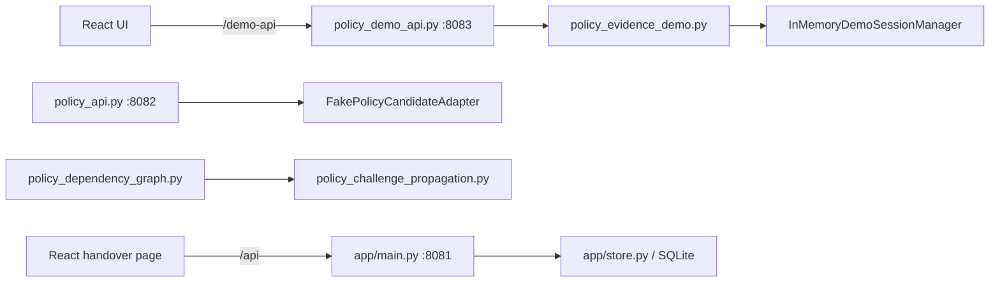

# System architecture

## System boundary

The repository contains separate applications and isolated domain modules. The launcher described in `POLICY_DEMO_WALKTHROUGH.md` starts the policy demo API and Vite UI. It does not establish that every backend service is connected to that UI.

The diagram shows code-level boundaries, not a running deployment. Policy graph/planner connection to the demo API is not asserted. The policy comparison API is separately documented on port 8082 and is not in the Vite demo proxy. The older handover UI calls `/api`; its backend is a different service.

## Components

| Component | Responsibility | Connection status |
|---|---|---|
| `frontend/src/App.tsx`, `PolicyDemoPage.tsx` | React/TypeScript handover and policy demo experiences; hash `#/demo` selects the policy page. | Implemented; Vite proxies `/api` and `/demo-api`. |
| `backend/app/main.py` | FastAPI handover routes and startup provider selection. | Separate API at 8081; `MockProvider` default, optional Meta provider. |
| `backend/app/provider_activation.py`, `provider_safety.py`, `httpx_transport.py` | Guarded provider activation, validation boundary, and fixed Meta transport. | Meta requires explicit backend environment configuration; no credential is sent to the frontend. |
| `backend/app/store.py` | Legacy store, SQLite connection and transaction functions. | Used by the legacy API in source; state not inspected. |
| `backend/policy_demo_api.py` | Scenario, session, history, reset, challenge endpoints. | In-memory demo path, port 8083. |
| `backend/policy_evidence_demo.py` | Three synthetic cases and scenario/challenge calculations. | Used by demo path. |
| `backend/policy_api.py` | Strict synthetic pair API. | Separate isolated service, port 8082; not proxied by demo Vite config. |
| `backend/policy_candidate_adapter.py` | Fake candidate generator and strict output validation. | Used by policy comparison API; no external model. |
| `backend/policy_dependency_graph.py` | Typed immutable graph, node/edge validation and projection. | Internal module; no HTTP route identified. |
| `backend/policy_challenge_propagation.py` | Bounded traversal and impact plan. | Internal module; does not persist or recalculate policy. |
| Phase 20A contract and vectors | Future deterministic snapshot persistence specification. | Documentation only; gates remain BLOCKED/CLOSED. |

## Data flow

For the policy demo, the browser loads the scenario catalog, requests a scenario, creates or resets a session, submits a challenge, and displays returned scenario/history state. The server keeps session audit events in process memory. For the separate comparison API, a supplied pair is validated, a deterministic fake candidate is generated, and a proposal-only result is validated and returned without persistence. For the legacy handover app, records and investigations flow through `/api` to `app.store` and its SQLite operations.

The graph/planner path is currently a Python module boundary. The persistence design proposes a normalized SQLite representation but governance has not authorized execution. No provider-to-policy graph integration is evidenced.

## Provider boundary

The handover `AssessmentEngine` uses `MandatoryProviderBoundary` and defaults to `MockProvider`; Meta Muse Spark is an optional explicitly activated backend provider. Each new claim records attribution from the invoked instance and optional validated request ID/token usage; legacy claims resolve to `unknown`. The policy API uses `FakePolicyCandidateAdapter`, while the React Policy Demo uses synthetic scenario logic. These paths are separate: enabling Meta does not connect it to either policy-demo workflow.
